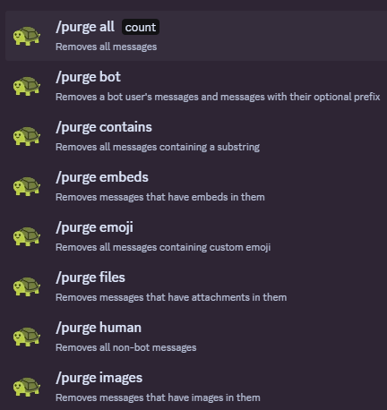
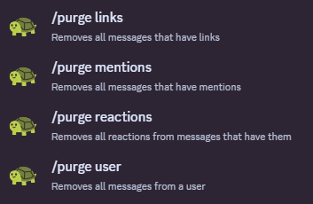

# Table of Contents
1. Systems
2. [Events](#events)
3. [Commands](#commands)

## Systems
- Autorole
- Reaction Roles
- Modlog (See [Events](#events))
- Commands (See [Commands](#commands))
- Sticky Roles
- Chat filter?
- Ticket system
- Leveling system?
- Servers Stats (toggleable)

## Events
| **#** | **Priority** | **Event** | **Joinlog** | **Done** |
|---|---|---|---|---|
| **1** | 1 | MessageDelete |  | ✓ |
| **2** | 1 | MessageBulkDelete |  | ✓ |
| **3** | 1 | MessageUpdate |  | ✓ |
| **4** | 1 | GuildMemberAdd | ✓ | ✓ |
| **5** | 1 | GuildMemberRemove | ✓ | ✓ |
| **6** | 1 | GuildMemberUpdate |  | ✓ |
| **7** | 1 | GuildBanAdd |  | ✓ |
| **8** | 1 | GuildBanRemove |  | ✓ |
| **9** | 2 | GuildRoleCreate |  | ✓ |
| **10** | 2 | GuildRoleDelete |  | ✓ |
| **11** | 2 | GuildRoleUpdate |  | ✓ |
| **12** | 2 | InviteCreate |  | ✓ |
| **13** | 2 | InviteDelete |  | ✓ |
| **14** | 2 | UserUpdate |  | ✓ |
| **15** | 3 | ThreadCreate |  |  |
| **16** | 3 | ThreadDelete |  |  |
| **17** | 3 | ThreadUpdate |  |  |
| **18** | 3 | GuildEmojiCreate |  |  |
| **19** | 3 | GuildEmojiDelete |  |  |
| **20** | 3 | GuildEmojisUpdate |  |  |
| **21** | 3 | GuildStickerCreate |  |  |
| **22** | 3 | GuildStickerDelete |  |  |
| **23** | 3 | GuildStickerUpdate |  |  |
| **24** | 3 | GuildScheduledEventCreate |  |  |
| **25** | 3 | GuildScheduledEventDelete |  |  |
| **26** | 3 | GuildScheduledEventUpdate |  |  |
| **27** | 3 | GuildScheduledEventUserAdd |  |  |
| **28** | 3 | GuildScheduledEventUserRemove |  |  |
| **29** | 3 | GuildSoundboardSoundCreate |  |  |
| **30** | 3 | GuildSoundboardSoundDelete |  |  |
| **31** | 3 | GuildSoundboardSoundUpdate |  |  |

## Commands
- Replace `prune` with `purge` (see images below)
- Kick
- Nick/unnick
- Mute/unmute
- Lockdown
- Massrole
- Role add/remove <user> <role>
- Coinflip
- Random (string, number)
- Poll
- Remindme

## Other

## How commands should be deployed
| Command | Development | Production |
| ----- | ----- | ----- |
| `isDev: true` & `servers: null` | Dev Server | Dev Server |
| `isDev: false` & `servers: null` | Dev Server | Global |
| `isDev: true` & `servers: ['Dev_id']` | Dev Server | Dev Server |
| `isDev: true` & `servers: ['Dev_id', 'Server_A']` | Dev Server | Dev Server |
| `isDev: false` & `servers: ['Dev_id', 'Server_A']` | Dev Server | All servers in the servers array |
| `isDev: false` & `servers: ['Server_A']` | Not deployed | All servers in the servers array |
| `isDev` & `servers` missing | Not deployed + warning | Not deployed + warning |
